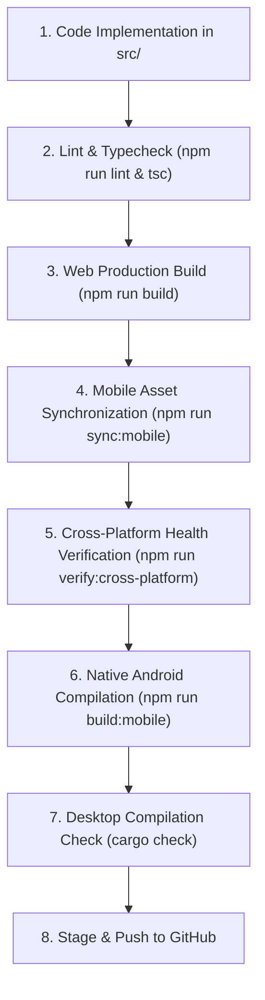

# VISTAAR — Cross-Platform Synchronization & Development Standard

> **Permanent Project Standard:** This document governs all feature development, bug fixes, refactoring, and releases for the VISTAAR Business OS ecosystem. Every application update must be evaluated, synchronized, and verified across all three supported platforms: **Web**, **Desktop**, and **Mobile**.

---

## 1. Supported Platform Matrix

| Platform | Runtime Environment | Native Framework | Distribution Artifact | Target Devices |
|:---|:---|:---|:---|:---|
| **VISTAAR Web** | Modern Browsers (Chrome, Edge, Firefox, Safari) | React 19 + Vite | `dist/` production bundle | Cloud & Localhost |
| **VISTAAR Desktop** | Native Desktop Host (Windows, macOS, Linux) | Tauri 2.x (Rust) + Webview2 | `release/VISTAAR-Setup.exe` (NSIS) | PCs, Workstations, Laptops |
| **VISTAAR Mobile** | Native Mobile Host (Android 8.0+, iOS 14+) | Capacitor 8.x (Java/Kotlin, Swift) | `app-debug.apk` / `app-release.aab` | Phones, Tablets, POS Terminals |

---

## 2. Universal Update Policy

Whenever a feature, bug fix, UI enhancement, or database change is introduced:

1. **Shared Implementation First:** Write business logic, calculations, database queries, and state management in the shared `src/` hierarchy.
2. **Platform Adaptation:** 
   - **Desktop:** Validate keyboard shortcuts (e.g., `Ctrl+K` for global search, `Ctrl+B` for sidebar toggle), large-screen layout grids, window constraints, and system tray/file dialogs.
   - **Mobile:** Validate responsive touch targets (minimum 44x44px), `MobileNav.tsx` drawer/modal flows, notch and navigation bar safe areas (`env(safe-area-inset-top)` / `env(safe-area-inset-bottom)`), hardware back button handling, and camera/scanner permissions.
   - **Web:** Validate cross-browser responsive layouts across mobile, tablet, laptop, and ultra-wide monitor breakpoints.
3. **Zero Silent Exclusivity:** No feature shall be developed exclusively for Web unless there is a concrete, documented technical impossibility on native devices.

---

## 3. Shared Architecture & Code Organization

```
d:\Project\vistaar-main\vistaar-main\
├── src/                               # SHARED FRONTEND (100% Cross-Platform)
│   ├── components/                    # Shared React UI components & Layouts
│   │   ├── Header.tsx                 # Desktop / Laptop Header
│   │   ├── MobileNav.tsx              # Mobile Top Header & Bottom Navigation Drawer
│   │   └── GlobalSearch.tsx           # Shared Omnisearch Control
│   ├── platform/                      # UNIVERSAL PLATFORM ABSTRACTION LAYER
│   │   ├── platformDetection.ts       # Runtime environment discriminator (Web vs Desktop vs Mobile)
│   │   ├── cameraService.ts           # Unified Camera API (Capacitor Camera vs HTML5 getUserMedia)
│   │   ├── clipboardService.ts        # Unified Clipboard API (Tauri vs Capacitor vs navigator.clipboard)
│   │   ├── fileService.ts             # Unified File I/O & PDF storage
│   │   ├── networkService.ts          # Unified Network status & offline detection
│   │   ├── notificationService.ts     # Unified Local Push Notifications
│   │   ├── printService.ts            # Unified Document & Receipt Thermal Printing
│   │   ├── qrScannerService.ts        # Unified Barcode & QR Code Scanner
│   │   ├── shareService.ts            # Unified Native Share Sheet vs Web Share
│   │   └── windowService.ts           # Unified Window Controls (Minimize, Maximize, Fullscreen)
│   ├── services/                      # SHARED BUSINESS LOGIC & SUPABASE INTEGRATION
│   │   ├── financialCalculationService.ts # Single source of truth for GST, totals, Udhari
│   │   ├── store.ts                   # Unified client persistence & cache
│   │   └── supabase/                  # Authoritative cloud API & data access layer
│   └── views/                         # Shared module screens
├── src-tauri/                         # DESKTOP NATIVE LAYER (Tauri 2.x Rust)
│   ├── tauri.conf.json                # Desktop window configuration & dist binding
│   └── Cargo.toml                     # Rust native dependencies
├── android/                           # MOBILE ANDROID NATIVE LAYER (Capacitor 8.x)
│   ├── app/                           # Android application manifest, build.gradle, native plugins
│   └── gradlew.bat                    # Gradle build wrapper
├── ios/                               # MOBILE iOS NATIVE LAYER (Capacitor 8.x)
└── release/                           # OFFICIAL RELEASE ARTIFACTS & SHA-256 MANIFESTS
    ├── checksums.txt                  # Cryptographic SHA-256 verification ledger
    └── VISTAAR-Setup.exe              # Certified Desktop Windows Installer
```

---

## 4. Platform Abstraction Layer Reference

All native hardware and OS interactions must flow through `src/platform/index.ts`. Never import `@capacitor/*` or `@tauri-apps/*` directly in UI views without using the abstraction layer:

```typescript
import {
  currentPlatform,      // { platform, isWeb, isDesktop, isAndroid, isIOS, isNativeMobile, hasTouch }
  cameraService,        // capturePhoto(), pickImage()
  clipboardService,     // writeText(), readText()
  fileService,          // saveDocumentPdf(), pickFile()
  printService,         // printHtml(), printPdf()
  notificationService,  // scheduleNotification(), checkPermissions()
  shareService,         // shareFile(), shareText()
  windowService,        // minimize(), maximize(), isMaximized()
} from '../platform';
```

---

## 5. Automated Build & Verification Commands

Use the unified npm scripts configured in `package.json`:

| Command | Action Performed |
|:---|:---|
| `npm run build` | Compiles Web TypeScript and bundles production assets into `dist/`. |
| `npm run sync:mobile` | Copies freshly built `dist/` web assets into `android/` and `ios/` projects via Capacitor CLI. |
| `npm run build:mobile` | Executes Android Gradle wrapper (`gradlew.bat assembleDebug`) to compile the native APK. |
| `npm run build:desktop` | Invokes Tauri CLI to build the native desktop bundle and installer. |
| `npm run verify:cross-platform` | Executes the automated 9-point health and synchronization test suite. |
| `npm run build:cross-platform` | Runs full automated pipeline: Web build → Mobile sync → Verification → APK build → Desktop check. |

---

## 6. Standard Cross-Platform Release Workflow

Follow this procedure before merging or publishing any change:



---

## 7. Mandatory Cross-Platform Completion Report

Every major development task or PR must conclude with the following completion report:

| Platform | Status | Artifact / Target Location | Verification Details |
|:---|:---|:---|:---|
| **Web Application** | Implemented | `dist/` | Tested responsive layouts on Desktop, Laptop, and Tablet. |
| **Desktop Application** | Implemented | `src-tauri/` / `release/VISTAAR-Setup.exe` | Verified window bounds, shortcuts (`Ctrl+B`, `Ctrl+K`), and cargo build. |
| **Mobile Application** | Implemented | `android/app/build/outputs/apk/debug/app-debug.apk` | Verified touch targets, `MobileNav`, safe-area insets, and APK assembly. |

### Technical Change Ledger
- **Shared Components Modified:** e.g., `Header.tsx`, `GlobalSearch.tsx`, `App.tsx`
- **Platform-Specific Files Modified:** e.g., `capacitor.config.ts`, `tauri.conf.json`
- **Database / API Operations:** Authoritative Supabase queries and RLS compliance verified
- **Automated Tests Executed:** `verify_cross_platform_synchronization.cjs` (9/9 Passed)
- **Known Limitations:** Document any hardware or platform-specific constraint if applicable

